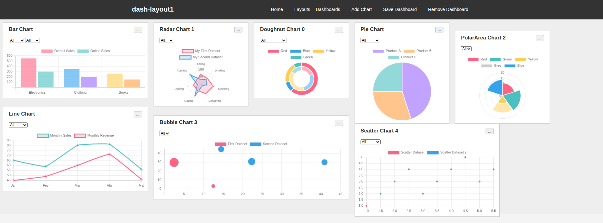

# Ivan-Vanko Dashboarding Tool

[readme-pt-Hammer](00doc/readme-pt.md). \


"your software is a shit!"



## About the System

Ivan-Vanko is a platform designed for creating and visualizing interactive dashboards from data sources. The goal is for the user to be able to configure an API URL and the system will automatically assemble and display the charts corresponding to the consumed data.

**Current Status:** Currently, the system uses a simulation service (`services/chart.service.js`) to generate sample data dynamically. This allows for development and testing of the visualization interface without the need for a real data backend. Interaction with UI filters triggers the generation of new random data, simulating an API query.

The architecture is service-based, allowing for easy integration of new data sources and chart types.

## Complementary Projects

**Ivan-Vanko** works in conjunction with [Justin-Hammer](https://github.com/mateusmed/justin-hammer). \
While Ivan-Vanko is responsible for generating and displaying charts, Justin-Hammer acts in data simulation or connecting with hosts to obtain this information, serving as a robust data source for the dashboards.

## How to Run

1. Install the dependencies:
   ```bash
   npm install
   ```
2. Start the server:
   ```bash
   node server.js
   ```
3. Open your browser at `http://localhost:3000`.
